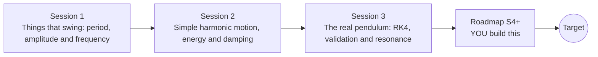

# openoscillator

[](https://github.com/KrunalPanchal1995/openoscillator/actions/workflows/ci.yml)   [](https://colab.research.google.com/github/KrunalPanchal1995/openoscillator/blob/main/sessions/session-01/lesson.ipynb) [](https://krunalpanchal1995.github.io/openoscillator/)

**Tune a pendulum or a spring to the exact period you want, in three sessions.**

openoscillator teaches oscillations from a swinging pendulum to resonance, using only Python and a browser, and ends with tuning a spring-mass system to a target frequency.

- **Start from a swing.** Session 1 needs only a square root and a stopwatch idea; the period formulas are explained from scratch.
- **See it move.** Every session ships a slider app that runs in the browser, with labelled graphs, energy bars and a resonance curve.
- **Know you got it right.** Each session ends with a checkpoint that prints PASS or FAIL against hand calculations and exact results.
- **Build the missing half.** The repo stops at Session 3 on purpose; the roadmap shows the path to the Target.

[Target](#the-target) · [Who is this for](#who-is-this-for) · [Quick start](#quick-start) · [Sessions](#sessions) · [Roadmap](#roadmap) · [Contribute](#contribute) · [Explainer PDF](docs/explainer.pdf)

> **This repo is incomplete on purpose.** Sessions 1 to 3 are here and fully working. The finished Target below is a preview of what the community can build next. We show you the path, not the code. Sessions 4 and up are yours.

## The Target

A pendulum released from 100 degrees swings with damping while three panels follow it: its phase portrait spirals inwards, energy bars show potential and kinetic energy trading places while the energy lost to damping grows, and a resonance curve shows how sharply the same oscillator would respond to a periodic push, with its quality factor Q. A faint copy swinging by the small-angle formula drifts out of step with the real pendulum. Your goal over the coming sessions: build these panels yourself and then tune the oscillator to a target period.


*Target: a damped pendulum with phase portrait, energy bars and the resonance curve*


*Target still: the pendulum a little way into its decay*


*Resonance curves for four damping values, and how the period grows with amplitude*

Try it live:

- [Math Visual Studio: rigid-body dynamics (Atlas S46)](https://krunalpanchal1995.github.io/studio/#atlas?ch=S46&ex=1)
- [Math Visual Studio: simple harmonic motion (Atlas S47)](https://krunalpanchal1995.github.io/studio/#atlas?ch=S47&ex=1)

How the Target was made is shown only as a path in [promo/roadmap.md](promo/roadmap.md).

## Who is this for
**secondary school to diploma / undergraduate (levels 3-5).** Topic area: Physics and the Science of Motion.

Prerequisites:

- School algebra, square roots, and sine and cosine of an angle.
- Python 3.10 or newer; if `python --version` works, you are ready. PRIMER.md explains the rest.
- No prior GitHub, calculus or physics-simulation experience is needed; Session 3 explains the numerical method it uses.

New to Python? Read [PRIMER.md](PRIMER.md) first (10 minutes).

## Quick start

No installation knowledge needed. You need [Git](https://git-scm.com/downloads) and [Python 3.10+](https://www.python.org/downloads/) (Windows: tick "Add Python to PATH"). On Mac and Linux type `python3` wherever this page says `python`.

```bash
git clone https://github.com/KrunalPanchal1995/openoscillator.git
cd openoscillator
python start.py 1
```

`start.py` creates a private environment, installs what is needed and runs Session 1 with its checkpoint. Next: `python start.py 2`, `python start.py 3`, or `python start.py test` to check everything. Only a checkpoint: `python start.py check 1`.

Four lines turn the idea of Session 1 into a result (they work as they are): Save it as `try.py` and run it with `python start.py run try.py` (this uses the private environment, where NumPy is installed):

```python
import numpy as np
L = 0.994                                      # pendulum length in metres
T = 2 * np.pi * np.sqrt(L / 9.81)              # period of a small swing
print(f"{T:.3f} s")                            # -> 2.000 s : the 'seconds pendulum'
```

Every session also opens in your browser with sliders (no install): [live apps](https://krunalpanchal1995.github.io/openoscillator/). Or use the Colab badge above for the notebook.

## Sessions

| # | Session | Model level | Time | Live app |
|---|---|---|---|---|
| 1 | [Things that swing: period, amplitude and frequency](sessions/session-01/README.md) | Level 1: conceptual interactive model | 60 min | [open](https://krunalpanchal1995.github.io/openoscillator/session-01/) |
| 2 | [Simple harmonic motion, energy and damping](sessions/session-02/README.md) | Level 2: mathematical engineering model | 75 min | [open](https://krunalpanchal1995.github.io/openoscillator/session-02/) |
| 3 | [The real pendulum: RK4, validation and resonance](sessions/session-03/README.md) | Level 3: simulation and validation | 90 min | [open](https://krunalpanchal1995.github.io/openoscillator/session-03/) |

Each session follows the same six steps: A real-world problem, B concept and theory, C visual explanation, D interactive simulation, E worked example and experiment, F assessment and design challenge. Each ends with `checkpoint.py`, which prints `PASS` or `FAIL` against reference numbers. Session 3 also contains the real-world mini-project: **Tune a spring so a phone sensor bounces at 2 Hz**.

## Architecture



| Folder or file | What is inside |
|---|---|
| `sessions/` | three sessions: README (A-F), `lesson.py`, notebook, live app, exercises, activity sheet, checkpoint |
| `promo/` | the Target: media, live links, and the roadmap (path only) |
| `docs/` | `explainer.tex` and the built `explainer.pdf` |
| `tests/` | runs every lesson and checkpoint headless |
| `start.py` | one command to set up and run anything |
| `QUALITY.md`, `RUBRIC.md` | the quality checklist and the scoring rubric |
| `.github/` | CI, PDF build, Pages deploy, issue and PR templates |

## Roadmap

| Milestone | What you will build | Difficulty |
|---|---|---|
| Session 4: Chaos in the driven pendulum | A driven version of the RK4 pendulum with phase portrait and a pair of nearby starting angles. | advanced |
| Session 5: Fit a phone recording | A fitting function for a damped cosine and a synthetic 'accelerometer recording' to test it. | intermediate |
| Session 6: Coupled pendulums and beats | Two identical pendulums joined by a weak spring, simulated with RK4. | intermediate |
| Session 7: Pumping a swing: parametric resonance | A small-angle pendulum whose length is modulated in time. | advanced |
| Session 8: Hardening spring: the resonance curve bends | A driven oscillator with a cubic spring term, swept up and then down in frequency. | advanced |

Full detail with a checkpoint per milestone: [promo/roadmap.md](promo/roadmap.md).

## Contribute
New to GitHub? Read [CONTRIBUTING.md](CONTRIBUTING.md); it starts from zero. Pick an issue labelled `good first issue`. Translations into Hindi, Telugu, Tamil and Malayalam are welcome.

<details>
<summary>Development</summary>

```bash
python start.py test        # runs every lesson and checkpoint
```
Lessons use `# %%` cell markers so they open as notebooks in VS Code. See [QUALITY.md](QUALITY.md) for the standard every session meets.
</details>

## License
MIT. See [LICENSE](LICENSE). Media in `promo/media` is (c) Krunal Panchal, CC BY 4.0.

## Acknowledgments
Part of the [PAN IIT OSS](https://hellofoss.tech-iitb.org/projects) open-source teaching collection, modelled on the structure of [openspline](https://github.com/openspline/openspline). Built on ideas from the Math Visual Studio at https://krunalpanchal1995.github.io/studio/.
