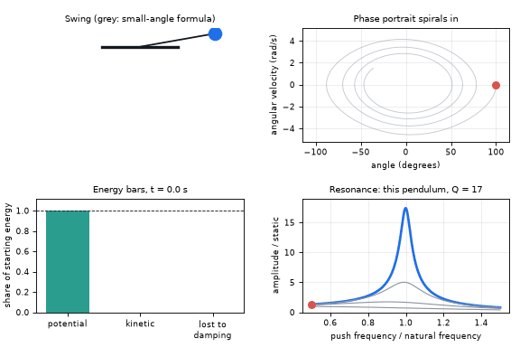
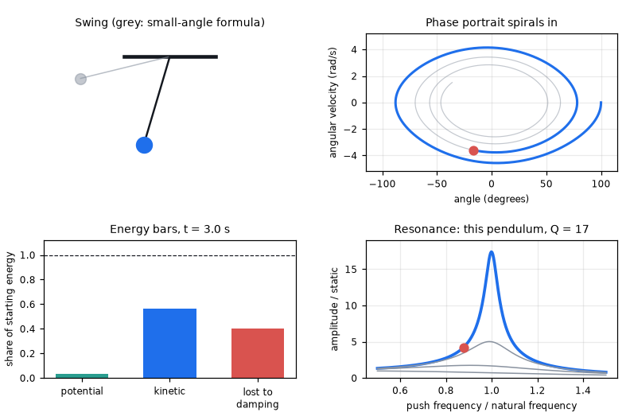
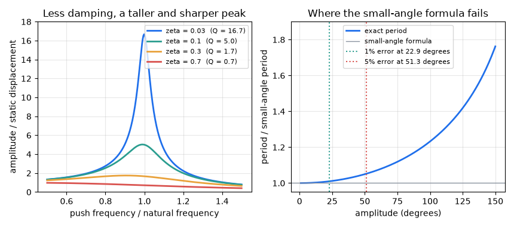

# What you are building toward

A pendulum released from 100 degrees swings with damping while three panels follow it: its phase portrait spirals inwards, energy bars show potential and kinetic energy trading places while the energy lost to damping grows, and a resonance curve shows how sharply the same oscillator would respond to a periodic push, with its quality factor Q. A faint copy swinging by the small-angle formula drifts out of step with the real pendulum. Your goal over the coming sessions: build these panels yourself and then tune the oscillator to a target period.

*Target: a damped pendulum with phase portrait, energy bars and the resonance curve*

*Target still: the pendulum a little way into its decay*

*Resonance curves for four damping values, and how the period grows with amplitude*

These results come from a private reference build. The code is not published; the roadmap shows the path so you can build your own.

Live links:

- [Math Visual Studio: rigid-body dynamics (Atlas S46)](https://krunalpanchal1995.github.io/studio/#atlas?ch=S46&ex=1)
- [Math Visual Studio: simple harmonic motion (Atlas S47)](https://krunalpanchal1995.github.io/studio/#atlas?ch=S47&ex=1)
