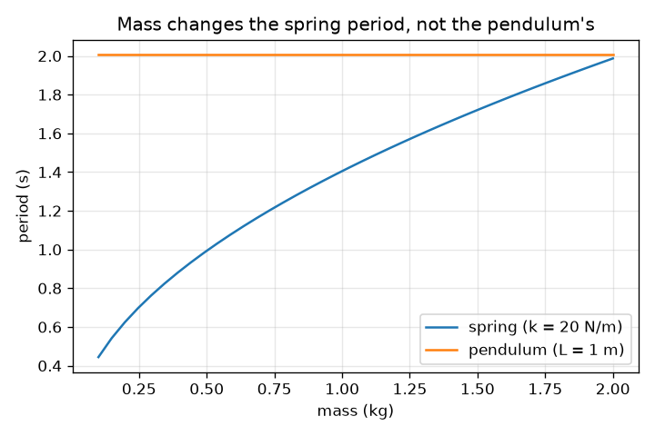
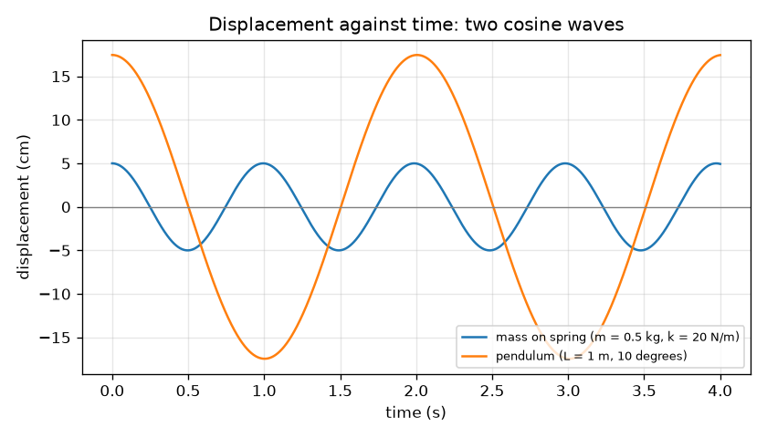

# Session 1: Things that swing: period, amplitude and frequency

*Level 1 (conceptual interactive model) · about 60 minutes · openoscillator*

> This is a simplified educational model. It is not a validated design tool and must not be used for real structures, electrical installations, vehicles, industrial processes or medical decisions.

**Prerequisites**

- School algebra and square roots.
- You have read PRIMER.md and run `python start.py 1` once.

**Learning objectives.** After this session you can:

- Define period, amplitude and frequency, and convert between period and frequency.
- Use T = 2 pi sqrt(L / g) and T = 2 pi sqrt(m / k) to predict a period.
- Read the period and amplitude from a graph of displacement against time.
- Say which quantities do and do not change the period of a pendulum.

## A. Real-world problem
A playground swing, a grandfather clock and the bouncing of a bike seat all repeat a motion again and again. How long does one swing take? How far does it go? Does a heavier child swing faster? These are questions about the period, the amplitude and the frequency of a swing, and a short graph of position against time answers all three.

## B. Concept and theory
A swing that repeats is called an oscillation. One full back-and-forth takes the period T (seconds). The number of swings per second is the frequency f = 1 / T (hertz, Hz). The largest distance from the middle is the amplitude A. For small swings, the period of a mass m on a spring of stiffness k is T = 2 pi sqrt(m / k), and the period of a pendulum of length L is T = 2 pi sqrt(L / g), where g = 9.81 m/s^2. The pendulum period contains no mass and no amplitude: the pull of gravity and the inertia of the bob are both proportional to the mass, so the mass cancels. The position follows a cosine wave, x(t) = A cos(2 pi t / T), if the swing starts at its largest displacement.

| Symbol | Meaning | Unit |
|---|---|---|
| T | period: time for one full swing | s |
| f | frequency: swings per second, 1 / T | Hz |
| A | amplitude: largest displacement from the middle | m |
| m | mass hanging on the spring | kg |
| k | spring stiffness: force per metre of stretch | N/m |
| L | pendulum length from pivot to the centre of the bob | m |
| g | gravitational acceleration | m/s^2 |

**Assumptions**

- Small swings only (up to about 15 degrees for the pendulum); Session 3 shows what happens beyond that.
- No friction or air drag: the swing never dies away (Session 2 adds damping).
- The spring has no mass of its own and obeys Hooke's law; the string is massless and the bob is a point.

$$ T = 2\pi\sqrt{\frac{m}{k}}\qquad T = 2\pi\sqrt{\frac{L}{g}} $$

$$ f = \frac{1}{T} $$

$$ x(t) = A\cos\!\left(\frac{2\pi t}{T}\right) $$

## C. Visual explanation
The first figure draws displacement against time for a 0.5 kg mass on a 20 N/m spring (amplitude 5 cm, period 0.99 s) and a 1 m pendulum swung 10 degrees (arc amplitude 17.5 cm, period 2.01 s). Both are cosine waves that start at a crest; the spring wave repeats about twice as often. The second figure plots period against mass: the spring line rises like a square root, while the pendulum line is flat, so a heavier bob does not swing slower or faster.

*Period against mass: it grows for the spring and stays flat for the pendulum.*

*Displacement against time for a spring (T = 0.99 s) and a pendulum (T = 2.01 s).*

## D. Interactive simulation
Run the lesson (`python start.py 1`), then open the live app: [Session 1: a pendulum and a spring](https://krunalpanchal1995.github.io/openoscillator/session-01/) (or `app.html` in this folder). Move the pendulum length and the spring mass and stiffness, watch the two periods in the readout, then switch to the graph view to see the two cosine waves (scaled to the same height) fall in and out of step.

**Challenge.** Make the pendulum and the spring swing in step: their periods must differ by less than 0.05 s.

## E. Worked example and experiment
**Problem.** A 0.5 kg mass hangs on a 20 N/m spring, and a 1.0 m pendulum swings next to it. Find each period and frequency, and check the pendulum with a time measurement.

1. Spring: m / k = 0.5 / 20 = 0.025 s^2, sqrt = 0.1581 s, so T = 2 pi * 0.1581 = 0.993 s and f = 1 / 0.993 = 1.007 Hz.
2. Pendulum: L / g = 1.0 / 9.81 = 0.1019 s^2, sqrt = 0.3193 s, so T = 2 pi * 0.3193 = 2.006 s and f = 0.498 Hz.
3. The pendulum is about twice as slow: 2.006 / 0.993 = 2.02.
4. Check from the graph: counting upward zero crossings of the sampled spring curve, the program measures 0.9935 s, equal to the formula.

**Answer.** Spring: T = 0.993 s, f = 1.007 Hz. Pendulum: T = 2.006 s, f = 0.498 Hz.

**Experiment.** Tie a small weight to a 1.00 m string, swing it through about 10 degrees and time 20 swings with a phone stopwatch; divide by 20. Expect about 40.1 s, so T = 2.01 s. Human reaction adds about 0.2 s of error on the whole count, only 0.01 s per swing. A bigger swing, a heavy string or a large bob (whose centre of mass sits lower than the string length) makes the real value a little different: the model is exact for a point bob on a massless string, your pendulum is not.

## F. Assessment and design challenge
**Question type A: Conceptual.** A heavy bob and a light bob hang from strings of the same length. Which one has the longer period for small swings? Explain why the mass does not appear in T = 2 pi sqrt(L / g), and why it does appear for a spring.

Hint

Compare how the restoring force and the inertia depend on the mass in each case.

Step-by-step solution

They have the same period. The pull of gravity along the swing is proportional to the mass, and so is the inertia (resistance to acceleration), so the mass cancels. For a spring, the restoring force k x does not grow with the mass, but the inertia does, so a larger mass accelerates less and the swing is slower: T grows like sqrt(m).

**Question type B: Numerical.** Find the period and frequency of a pendulum of length 0.25 m. By what factor does the period change if the length is made four times as long?

Hint

T = 2 pi sqrt(L / g) with g = 9.81 m/s^2. A factor of 4 inside a square root becomes a factor of 2.

Step-by-step solution

L / g = 0.25 / 9.81 = 0.02548 s^2, sqrt = 0.1596 s, T = 2 pi * 0.1596 = 1.003 s and f = 1 / 1.003 = 0.997 Hz. Four times the length (1.0 m) gives T = 2.006 s, twice as long. Sanity check: a 25 cm pendulum is a short one, about one swing per second, which feels right.

**Question type C: Graph and simulation interpretation.** On the graph, the spring wave (T = 0.99 s) starts at a crest at t = 0. At about what time does it first cross zero, and how many full swings does the pendulum (T = 2.01 s) make in 6 s?

Hint

A cosine crosses zero a quarter of a period after a crest.

Step-by-step solution

A quarter period is 0.993 / 4 = 0.248 s, so the spring wave first crosses zero at about 0.25 s, going downward. The pendulum makes 6 / 2.006 = 2.99, about 3 full swings in 6 s (it is nearly back at a crest at t = 6 s).

**Question type D: Design and optimisation challenge.** Design: choose a pendulum length so that it swings in step with a 2.0 kg mass on a 20 N/m spring. State the period and say whether the answer is practical for a classroom.

Hint

First find the spring period, then solve T = 2 pi sqrt(L / g) for L: L = g (T / 2 pi)^2.

Step-by-step solution

Spring: T = 2 pi sqrt(2.0 / 20) = 1.987 s. Then L = 9.81 * (1.987 / 6.283)^2 = 9.81 * 0.1000 = 0.981 m. A string of about 1 m is easy to hang from a door frame, so it is practical. Trade-off: the match is only as good as the length and spring constant you can measure, and a small mismatch of 1 percent in L is 0.5 percent in T. Assumption: small swings.

Score yourself with [RUBRIC.md](../../RUBRIC.md). Print the [activity sheet](activity_sheet.md) to work on paper.

## Common misconceptions
| Common misconception | What is actually true |
|---|---|
| A heavier pendulum bob swings faster (or slower). | For small swings the period does not depend on the mass at all; only the length and gravity matter. |
| A bigger swing always takes longer. | For small swings the period is the same whatever the amplitude. A noticeable difference appears only for large swings (Session 3 measures it). |
| Frequency and period are different things that grow together. | They are inverses: f = 1 / T. A long period means a low frequency. |
| The amplitude is the distance from one end of the swing to the other. | It is the distance from the middle to one end, half of the total travel. |

## Glossary
- **oscillation**: a motion that repeats, such as a swing
- **period**: time for one complete back-and-forth swing, in seconds
- **frequency**: number of swings per second, in hertz; the inverse of the period
- **amplitude**: largest distance from the middle position
- **stiffness (k)**: how many newtons of force a spring gives per metre it is stretched

## Finish
1. Do the three coding tasks in [exercises.md](exercises.md).
2. Run `python start.py 1` again after your changes. It ends with the checkpoint; when it prints `PASS`, you are done. (Checkpoint only: `python start.py check 1`.)

Next: [Session 2](../session-02/README.md)
