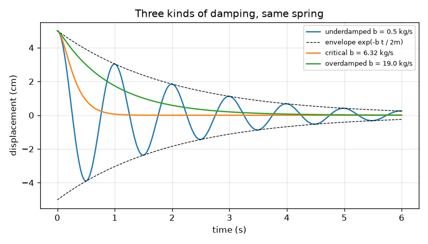
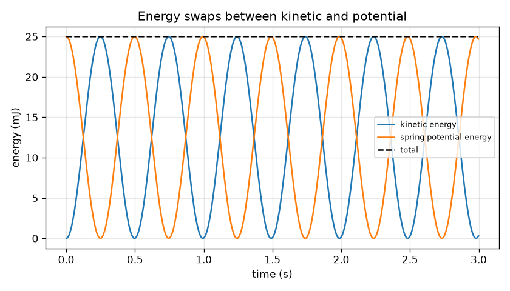

# Session 2: Simple harmonic motion, energy and damping

*Level 2 (mathematical engineering model) · about 75 minutes · openoscillator*

> This is a simplified educational model. It is not a validated design tool and must not be used for real structures, electrical installations, vehicles, industrial processes or medical decisions.

**Prerequisites**

- Session 1: period, amplitude and frequency.
- Squares, square roots and the exponential function exp(x) (explained in Section B).

**Learning objectives.** After this session you can:

- Write x = A cos(w t) with w = sqrt(k / m), and explain what each symbol means.
- Follow the exchange of energy between kinetic and potential energy during a swing.
- Tell underdamped, critically damped and overdamped motion apart, and compute the decay envelope.
- Solve a design problem: choose L, k or b to reach a target period or a target decay.

## A. Real-world problem
A clock must tick once every second. A phone sensor on a spring must bounce at a chosen rate. A car must stop bouncing after one or two swings, not twenty. In each case you must choose a length, a stiffness or a damping value, and that needs equations with the right units. Can you find the length of a pendulum that makes a 1 second tick, and the damper strength that makes a spring settle in about 3 seconds?

## B. Concept and theory
A spring pulls back with force F = -k x. Newton's second law, m x'' = -k x, says the acceleration x'' (the rate of change of the velocity) is proportional to the displacement and points back towards the middle. The solution is x(t) = A cos(w t) with the angular frequency w = sqrt(k / m) in rad/s, and the period is T = 2 pi / w. A small-angle pendulum has the same form with w = sqrt(g / L). This is called simple harmonic motion. The kinetic energy KE = (1/2) m v^2 and the spring energy PE = (1/2) k x^2 trade places, and their sum stays (1/2) k A^2. A damping force -b v removes energy at the rate b v^2. With the decay rate gamma = b / (2 m): if gamma < w0 (damping ratio zeta = b / (2 sqrt(k m)) below 1) the motion is underdamped: it still swings, with the slightly slower angular frequency wd = sqrt(w0^2 - gamma^2), inside an envelope that falls like exp(-b t / (2 m)). At b = 2 sqrt(k m) the motion is critically damped, the fastest return with no swing; above it, overdamped, a slow creep back. Design problems run the formulas backwards: L = g (T / 2 pi)^2 and k = m (2 pi / T)^2.

| Symbol | Meaning | Unit |
|---|---|---|
| x | displacement from the rest position | m |
| w0 | undamped angular frequency sqrt(k / m) | rad/s |
| b | damping coefficient: force per unit velocity | kg/s |
| gamma | decay rate b / (2 m) | 1/s |
| zeta | damping ratio b / (2 sqrt(k m)), 1 means critical | no unit |
| wd | damped angular frequency sqrt(w0^2 - gamma^2) | rad/s |
| KE, PE | kinetic and spring potential energy | J |

**Assumptions**

- Small swings: the pendulum restoring force is taken proportional to the angle.
- Damping force proportional to speed (viscous); real air drag grows faster at high speed.
- The spring is massless and obeys Hooke's law; released from rest at x = A.

$$ m\ddot x + b\dot x + kx = 0 $$

$$ x(t) = A\cos(\omega t),\qquad \omega=\sqrt{k/m},\qquad T=2\pi\sqrt{m/k},\qquad T=2\pi\sqrt{L/g} $$

$$ E = \tfrac12 m v^2 + \tfrac12 k x^2 = \tfrac12 kA^2\quad(\text{no damping}) $$

$$ x(t)\approx A\,e^{-bt/2m}\cos(\omega_d t),\qquad \omega_d=\sqrt{\frac{k}{m}-\Big(\frac{b}{2m}\Big)^2} $$

$$ b_{\text{crit}} = 2\sqrt{km},\qquad \zeta=\frac{b}{2\sqrt{km}},\qquad L=g\Big(\frac{T}{2\pi}\Big)^2 $$

## C. Visual explanation
The first figure shows the same 0.5 kg, 20 N/m spring with three dampings. With b = 0.5 kg/s it swings about 6 times in 6 s inside a shrinking envelope; with the critical value 6.32 kg/s it returns to rest without crossing zero and fastest; with 19 kg/s it creeps back slowly. The second figure shows the energy: kinetic and potential energy are two waves in opposite step whose sum is a flat line at 25 mJ (that is (1/2) k A^2 for A = 5 cm).

*Same spring, three dampings: underdamped with its envelope, critical and overdamped.*

*Kinetic and potential energy trade places; their sum stays at 25 mJ.*

## D. Interactive simulation
Run the lesson (`python start.py 2`), then open the live app: [Session 2: spring, mass and damper](https://krunalpanchal1995.github.io/openoscillator/session-02/) (or `app.html` in this folder). Slide the damping b from 0 up to above the critical value and watch the envelope, the energy graph and the readout. Then move the stiffness and mass and see the period change.

**Challenge.** Tune it: the damped period must be within 0.02 s of 1.0 s and the swing must fall to 10 percent or less of its start after 5 s while it still swings (underdamped).

## E. Worked example and experiment
**Problem.** A 0.50 kg mass on a spring must swing with a period of 1.0 s. Find k. Then add damping b = 0.5 kg/s and find the damped period, the damping ratio and what fraction of the swing is left after 5 s. Finally find the length of the 'seconds pendulum' with a full period of 2 s.

1. w = 2 pi / T = 6.283 rad/s, so k = m w^2 = 0.50 * 39.48 = 19.74 N/m.
2. Damping b = 0.5 kg/s: gamma = b / (2 m) = 0.5 / 1.0 = 0.5 1/s. Then wd = sqrt(39.48 - 0.25) = 6.263 rad/s and the damped period is 2 pi / 6.263 = 1.0032 s (a 0.3 percent change from 1.0 s).
3. Critical damping is 2 sqrt(k m) = 2 sqrt(19.74 * 0.5) = 6.283 kg/s, so zeta = 0.5 / 6.283 = 0.080: strongly underdamped.
4. After 5 s the envelope is exp(-gamma * 5) = exp(-2.5) = 0.082, or 8.2 percent of the start. Its time constant is 2 m / b = 2.0 s.
5. Seconds pendulum: L = g (T / 2 pi)^2 = 9.81 * (2 / 6.283)^2 = 9.81 * 0.10132 = 0.994 m. For a 1 s full period, L = 0.2485 m.

**Answer.** k = 19.74 N/m; damped period 1.003 s, zeta = 0.080, 8.2 percent of the swing left after 5 s; the seconds pendulum (T = 2 s) needs L = 0.994 m.

**Experiment.** Hang a 0.5 kg mass from a spring of known stiffness (measure k by the stretch: k = m g / extension), time 20 bounces with a stopwatch and compare with 2 pi sqrt(m / k). Expect the measured period to be a few percent longer than the formula, because the spring itself has mass (about one third of it moves with the load) and because of friction. For the seconds pendulum, a 0.994 m string with a small bob should tick once per second; if yours runs slow, the centre of the bob is lower than you measured. The model differs from reality through the spring mass, air drag (not exactly proportional to speed) and the pivot.

## F. Assessment and design challenge
**Question type A: Conceptual.** With no damping, the total energy stays constant while kinetic and potential energy change. Where is the energy at the end of the swing and where at the middle? When damping is switched on, where does the lost energy go?

Hint

Think about the speed at the ends and at the middle of a swing.

Step-by-step solution

At the ends of the swing the mass is momentarily at rest, so all the energy is stored in the spring (or, for the pendulum, in height): PE = (1/2) k A^2 and KE = 0. At the middle the spring is relaxed and the speed is largest, so all the energy is kinetic. With damping, energy is removed at the rate b v^2 and becomes heat in the damper and the air; the total falls, fastest when the speed is greatest.

**Question type B: Numerical.** A sensor of mass 0.20 kg must oscillate at 2 Hz on a spring. What stiffness is needed? What pendulum length would give a period of 1.5 s?

Hint

T = 1 / f = 0.5 s, then k = m (2 pi / T)^2. For the pendulum, L = g (T / 2 pi)^2.

Step-by-step solution

T = 0.5 s, so w = 2 pi / 0.5 = 12.57 rad/s and k = 0.20 * 157.9 = 31.58 N/m. Pendulum: L = 9.81 * (1.5 / 6.283)^2 = 9.81 * 0.05699 = 0.559 m. Sanity check: a 0.2 kg phone on a spring of 30 N/m is about right for a quick bounce, and a bit more than half a metre of string for a 1.5 s swing feels plausible.

**Question type C: Graph and simulation interpretation.** On the displacement graph for m = 0.5 kg, k = 20 N/m, b = 0.5 kg/s, read the time at which the envelope has fallen to half of its starting value, and compare with the formula.

Hint

The envelope is A exp(-b t / (2 m)); set it equal to A / 2.

Step-by-step solution

exp(-b t / 2m) = 0.5 gives t = 2 m ln 2 / b = 2 * 0.5 * 0.693 / 0.5 = 1.386 s. On the graph the dashed envelope crosses half height at about 1.4 s, which is a little more than one swing (T = 0.997 s). After a second half-time (2.77 s) a quarter is left.

**Question type D: Design and optimisation challenge.** Design: for the m = 0.5 kg, k = 20 N/m spring, choose a damping b so that the swing is at most 5 percent of its start after 3 s. Compare with critical damping and say what you would pick for a car suspension.

Hint

Require exp(-b * 3 / (2 * 0.5)) <= 0.05, and compare with the critical value 2 sqrt(k m).

Step-by-step solution

exp(-3 b) <= 0.05 needs b >= ln(20) / 3 = 0.9986, so b = 1.0 kg/s works: exp(-3) = 0.0498, 4.98 percent left, with zeta = 0.158 (it still swings about three times). Critical damping, b = 6.32 kg/s, would leave about 1e-7 of the start after 3 s and no swing at all, but it needs a much stronger damper, and an overdamped system is slow to follow bumps. Cars choose zeta between about 0.2 and 0.7 as a compromise: comfortable, but settling in one or two swings.

Score yourself with [RUBRIC.md](../../RUBRIC.md). Print the [activity sheet](activity_sheet.md) to work on paper.

## Common misconceptions
| Common misconception | What is actually true |
|---|---|
| Damping always makes the oscillation slower. | Light damping barely changes the period (1.003 s instead of 1.000 s in the worked example). The main effect is the shrinking envelope. Only heavy damping removes the swing. |
| Critical damping is the strongest damping. | It is the smallest damping that gives no swing. More damping (overdamped) makes the return slower. |
| The total energy of a swinging spring is zero at the middle. | It is entirely kinetic at the middle. Total energy is constant (1/2) k A^2; only the split between kinetic and potential changes. |
| Doubling the amplitude doubles the period. | In simple harmonic motion the period does not depend on the amplitude. The energy does: it grows four times, as A^2. |

## Glossary
- **simple harmonic motion**: motion where the restoring force is proportional to the displacement, giving a pure cosine wave
- **angular frequency**: w, radians per second; T = 2 pi / w
- **damping**: a force against the velocity that removes energy from the swing
- **envelope**: the curve that bounds the swing and shrinks like exp(-b t / 2m)
- **critical damping**: the smallest damping with no swinging: b = 2 sqrt(k m)
- **damping ratio**: zeta, damping divided by its critical value

## Finish
1. Do the three coding tasks in [exercises.md](exercises.md).
2. Run `python start.py 2` again after your changes. It ends with the checkpoint; when it prints `PASS`, you are done. (Checkpoint only: `python start.py check 2`.)

Next: [Session 3](../session-03/README.md)
