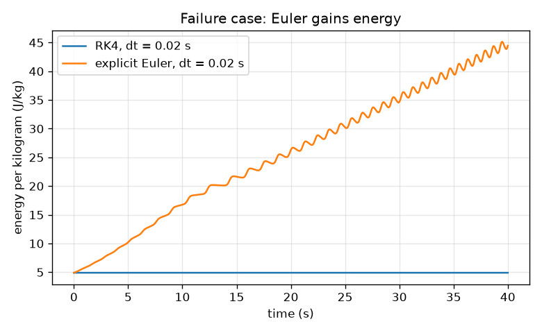
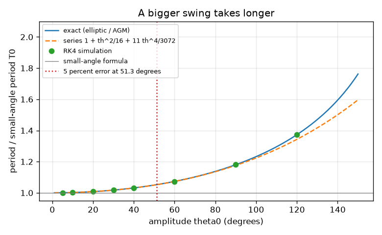
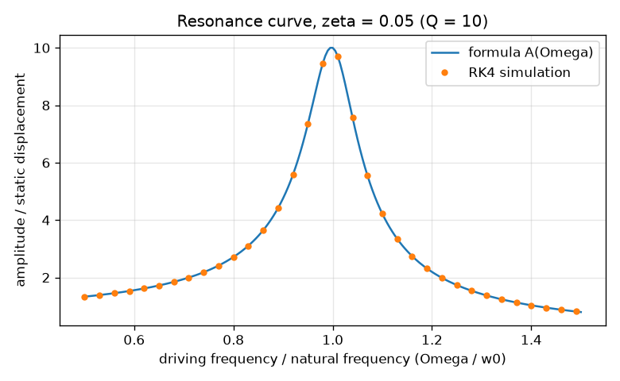

# Session 3: The real pendulum: RK4, validation and resonance

*Level 3 (simulation and validation) · about 90 minutes · openoscillator*

> This is a simplified educational model. It is not a validated design tool and must not be used for real structures, electrical installations, vehicles, industrial processes or medical decisions.

**Prerequisites**

- Session 1: period and amplitude.
- Session 2: simple harmonic motion, energy and damping.

**Learning objectives.** After this session you can:

- Simulate the nonlinear pendulum theta'' = -(g/L) sin(theta) - c theta' with the RK4 method.
- Validate a simulation against an analytic limit, energy conservation and a damped envelope.
- Explain and measure how the period grows with amplitude, and where the small-angle formula fails by 1 and 5 percent.
- Draw a resonance curve and read the quality factor Q; recognise when explicit Euler fails.

## A. Real-world problem
The formula T = 2 pi sqrt(L / g) is a small-angle approximation: the true restoring force on a pendulum is proportional to sin(theta), not theta. A clock whose pendulum swings too far runs slow. There is no neat formula for the whole motion, so we simulate it step by step, and then we must prove that the simulation can be trusted. We also push an oscillator with a periodic force and ask: at what frequency does a small push give the largest swing, and how sharp is that peak?

## B. Concept and theory
With angle theta and angular velocity omega, the damped pendulum obeys theta' = omega and omega' = -(g/L) sin(theta) - c omega. We advance it in small time steps dt. Explicit Euler uses only the slope at the start of each step, and its error is proportional to dt; RK4 combines four slopes (start, two middle estimates, end) and its error shrinks like dt^4. The exact period of the undamped pendulum released from rest at theta0 is T = T0 (2/pi) K(k) with k = sin(theta0/2) and K the complete elliptic integral of the first kind; this equals T0 / AGM(1, cos(theta0/2)), where the arithmetic-geometric mean AGM is found by repeatedly replacing (a, b) by their arithmetic and geometric means. For moderate angles, T = T0 (1 + theta0^2/16 + 11 theta0^4/3072 + ...). The simulation is validated by three tests: it must match the small-angle cosine at tiny amplitude, keep the energy constant when c = 0, and shrink successive maxima by exp(-c Td / 2) when damped. For a driven linear oscillator x'' + 2 zeta w0 x' + w0^2 x = F cos(Omega t) the steady amplitude is F / sqrt((w0^2 - Omega^2)^2 + (2 zeta w0 Omega)^2), which peaks near Omega = w0 at about 1 / (2 zeta) times the static displacement F / w0^2. That ratio is the quality factor Q.

| Symbol | Meaning | Unit |
|---|---|---|
| theta | angle from the downward vertical | rad (degrees in graphs) |
| omega | angular velocity theta' | rad/s |
| c | damping rate of the pendulum | 1/s |
| dt | time step of the solver | s |
| T0 | small-angle period 2 pi sqrt(L / g) | s |
| F | driving force per unit mass | m/s^2 |
| Omega | driving angular frequency | rad/s |
| Q | quality factor 1 / (2 zeta): peak height over static displacement | no unit |

**Assumptions**

- A point bob on a massless rigid string, swinging in a plane; no air drag except the linear term c omega.
- The pendulum is released from rest; amplitudes are below 180 degrees (the upright position is unstable and excluded).
- The driven oscillator is linear (small angle); resonance of the full nonlinear pendulum bends the curve, a roadmap topic.
- This is a teaching model, not a validated design tool for clocks or structures.

$$ \ddot\theta = -\frac{g}{L}\sin\theta - c\,\dot\theta $$

$$ y_{n+1} = y_n + \frac{\Delta t}{6}\left(k_1 + 2k_2 + 2k_3 + k_4\right) $$

$$ T = T_0\,\frac{2}{\pi}K(k)=\frac{T_0}{\mathrm{AGM}\big(1,\cos(\theta_0/2)\big)},\quad k=\sin\frac{\theta_0}{2} $$

$$ T \approx T_0\left(1+\frac{\theta_0^2}{16}+\frac{11\,\theta_0^4}{3072}\right) $$

$$ A(\Omega)=\frac{F}{\sqrt{(\omega_0^2-\Omega^2)^2+(2\zeta\omega_0\Omega)^2}},\qquad Q=\frac{1}{2\zeta} $$

## C. Visual explanation
The first figure plots the period divided by T0 against the amplitude. The exact curve rises from 1.00 at small amplitude to 1.03 at 40 degrees, 1.07 at 60 degrees and 1.37 at 120 degrees; the RK4 dots lie on the exact curve and the two-term series follows it up to about 90 degrees. The small-angle formula (the flat line 1.0) is 1 percent low at 22.9 degrees and 5 percent low at 51.3 degrees. The second figure is the resonance curve for zeta = 0.05: RK4 dots sit on the formula, the peak is 10 times the static displacement (Q = 10). The third shows the failure case: RK4 keeps the energy flat while explicit Euler's climbs.

*Failure case: explicit Euler gains energy, RK4 keeps it constant.*

*Period against amplitude: exact, series and RK4 points; the small-angle formula is the flat line.*

*Resonance curve for zeta = 0.05: RK4 dots on the formula, Q = 10.*

## D. Interactive simulation
Run the lesson (`python start.py 3`), then open the live app: [Session 3: the nonlinear pendulum](https://krunalpanchal1995.github.io/openoscillator/session-03/) (or `app.html` in this folder). Use the five views: watch the energy bars and the faint small-angle copy fall out of step at large angles, read the period graph, follow the phase portrait spiral inwards with damping, and see how damping sets the width of the resonance peak.

**Challenge.** Make the small-angle period formula wrong by more than 5 percent while keeping the damping at 0.1 per second or less.

## E. Worked example and experiment
**Problem.** A 1.0 m pendulum is released from 40 degrees. Find its exact period and compare it with the small-angle formula and the series. At which amplitude is the small-angle formula wrong by 5 percent? Validate the simulation, and show what Euler does.

1. T0 = 2 pi sqrt(1.0 / 9.81) = 2.0061 s.
2. Exact (AGM): cos(20 degrees) = 0.9397, AGM(1, 0.9397) = 0.9697, so T = 2.0061 / 0.9697 = 2.0689 s. The RK4 simulation (dt = 0.005 s) measures 2.0689 s.
3. Series: theta0 = 0.6981 rad, theta0^2/16 = 0.0305, 11 theta0^4/3072 = 0.00085, so T = 2.0061 * 1.0314 = 2.0689 s. The one-term series gives 2.0672 s.
4. The small-angle formula is low by (2.0689 - 2.0061) / 2.0689 = 3.04 percent at 40 degrees. It is 1 percent low at 22.9 degrees and 5 percent low at 51.3 degrees (bisection on the exact period). So about 40 degrees is already a 3 percent error, not yet 5.
5. Validation: for a 0.5 degree swing the largest difference between RK4 and 0.5 deg * cos(w t) over 10 s is about 1e-6 rad. Over 20 s at 60 degrees the energy drift is -5.4e-10 for RK4 (dt = 0.005 s) and +110 percent for explicit Euler with the same step. With damping c = 0.4 1/s, successive maxima ratio is 0.6689, against exp(-c Td / 2) = 0.6690.
6. Resonance: for zeta = 0.05, w0 = 2 pi rad/s, the RK4 amplitude peak is 10.00 times the static value and the half-power width gives Q = 9.90, against the formula 1 / (2 zeta) = 10.

**Answer.** T(40 degrees) = 2.0689 s, 3.04 percent above the small-angle 2.0061 s; the formula is 5 percent low at 51.3 degrees. RK4 passes the analytic, energy and envelope tests; Euler gains energy; Q = 10 for zeta = 0.05.

**Experiment.** Compare a pendulum swung through 10 degrees and through 50 degrees (a protractor on a door frame). Time 20 swings each: the exact periods are T(10 degrees) = 2.0099 s and T(50 degrees) = 2.1059 s, 4.8 percent longer, which is about 1.9 s over 20 swings and easy to see. For resonance, push a hanging mass on a spring with your hand at different rates and watch where the response is largest. Differences from the model: the string stretches, the bob is not a point, air drag is not linear, and the pivot rubs.

## Real-world application and mini-project: Tune a spring so a phone sensor bounces at 2 Hz
A phone (0.170 kg) is strapped to a coil spring of mass 0.030 kg and bounces up and down, measured by its accelerometer. Only stock springs of 10, 15, 20, 25, 30, 40 and 60 N/m are available, and the setup has a damping of about 0.2 kg/s. The target frequency is 2.0 Hz. Use `tune_spring` from Session 3 to pick the best spring, then `ballast_for_target` to find how much extra mass (coins taped to the strap) brings the damped frequency to 2.0 Hz, and confirm with `simulate_spring_mass`. This is a simplified model: a real mount adds strap flexing, air drag and sideways wobble, so treat the result as a starting point and measure.

**Deliverable:** A script that prints a table of frequency for every stock spring, names the best spring and its error against 2.0 Hz, prints the ballast mass in grams, simulates the tuned system with RK4 and prints the measured frequency, and saves a plot of displacement against time.

**Success looks like:** The 30 N/m spring is chosen (2.053 Hz, 2.6 percent too high), the ballast is 9.6 g, and the simulated frequency is 2.000 Hz to within 0.2 percent.

## F. Assessment and design challenge
**Question type A: Conceptual.** Why does the period of a real pendulum increase with amplitude, while a mass on an ideal spring has a period that does not?

Hint

Compare the restoring force sin(theta) with theta, and a spring's force k x.

Step-by-step solution

For a spring the restoring force is exactly proportional to the displacement, so the oscillation is simple harmonic and its period is independent of amplitude. For a pendulum the restoring force goes as sin(theta), which is smaller than theta at large angles (sin 60 degrees = 0.866 against 1.047 rad), so the pull-back is weaker than the small-angle model assumes, the acceleration is smaller and each swing takes longer.

**Question type B: Numerical.** A clock with a pendulum tuned to a 2.000 s period for small swings is driven so that it swings 30 degrees. By what percent is the period longer and how many seconds per day does the clock lose?

Hint

Use the series T = T0 (1 + theta0^2 / 16 + 11 theta0^4 / 3072) with theta0 in radians, then compare tick counts over 86400 s.

Step-by-step solution

theta0 = 0.5236 rad, theta0^2/16 = 0.01713, 11 theta0^4/3072 = 0.00027, so T = 2.000 * 1.0174 = 2.035 s (the exact value is 1.7409 percent larger). The clock ticks 1 / 1.0174 as often, so it loses 86400 * (1 - 1 / 1.0174) = 1478 s per day, about 24.6 minutes. Hence real clocks use a small amplitude of about 3 to 4 degrees.

**Question type C: Graph and simulation interpretation.** On the resonance curve for zeta = 0.05 the peak is at Omega / w0 = 0.9975 with height 10. Predict the peak height if the damping doubles to zeta = 0.1, and say what happens to the width of the peak.

Hint

Q = 1 / (2 zeta); the peak width at 1/sqrt(2) of the height is about w0 / Q.

Step-by-step solution

Q = 1 / (2 * 0.1) = 5 (the precise peak is 5.03 times the static displacement). The peak is half as high, and its width is about twice as large (w0 / Q goes from 0.1 w0 to 0.2 w0), so the oscillator responds less strongly but over a wider range of driving frequencies. Low damping means a tall, narrow, selective resonance (a radio tuner); high damping a low broad one (a car suspension).

**Question type D: Design and optimisation challenge.** Design: you need the pendulum energy to stay within 1 percent over 20 s (60 degrees). Compare RK4 with explicit Euler: which time step and how many steps does each need? Justify.

Hint

From the lesson output, RK4 drift at dt = 0.05 s is -5.7e-5; Euler at dt = 0.005 s is +110 percent. Euler's energy grows like exp(w^2 dt T).

Step-by-step solution

RK4 with dt = 0.05 s has a drift of 5.7e-5 (0.006 percent), far inside 1 percent, with only 400 steps of four slope evaluations each, 1600 evaluations. Explicit Euler at 10 times smaller steps (dt = 0.005 s, 4000 steps) still gains 110 percent. Since Euler's energy grows like exp(w^2 dt T) with w^2 = 9.81 and T = 20 s, a 1 percent limit needs dt of about 5e-5 s, a few hundred thousand steps (an estimate from the growth formula). RK4 is cheaper by two or three orders of magnitude here. Trade-off: RK4 does not conserve energy exactly either; over very long runs a symplectic method may be preferred.

Score yourself with [RUBRIC.md](../../RUBRIC.md). Print the [activity sheet](activity_sheet.md) to work on paper.

## Common misconceptions
| Common misconception | What is actually true |
|---|---|
| A smaller time step always makes Euler accurate enough. | Euler's energy error shrinks only in proportion to dt: even at dt = 0.005 s it gains 110 percent over 20 s here. RK4 is far better for the same effort. |
| The small-angle formula is accurate up to about 40 degrees. | It is already 3 percent low at 40 degrees; it is 1 percent low at 23 degrees and 5 percent low at 51 degrees. |
| Resonance means the amplitude grows without limit. | Only without damping. With damping the amplitude peaks at about Q times the static displacement and stays finite. |
| If a simulation produces smooth curves, it is correct. | Smooth curves can be wrong (Euler's growing swing is smooth). Validate against an exact result, a conservation law or a known decay rate. |

## Glossary
- **RK4**: Runge-Kutta 4: a solver that takes four slopes per step; its error shrinks like dt^4
- **explicit Euler**: the simplest solver, stepping along the slope at the start of the step
- **elliptic integral**: the integral K(k) that gives the exact pendulum period
- **AGM**: arithmetic-geometric mean: a fast loop that computes K(k)
- **resonance**: the large response of an oscillator to a push at about its natural frequency
- **Q factor**: quality factor 1 / (2 zeta): how tall and sharp the resonance peak is
- **phase portrait**: a plot of velocity against position; closed loops mean constant energy

## Finish
1. Do the three coding tasks in [exercises.md](exercises.md).
2. Run `python start.py 3` again after your changes. It ends with the checkpoint; when it prints `PASS`, you are done. (Checkpoint only: `python start.py check 3`.)

Next: the [roadmap](../../promo/roadmap.md). Session 4 is yours to build.
